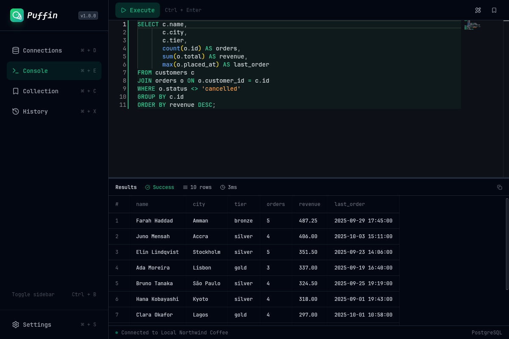
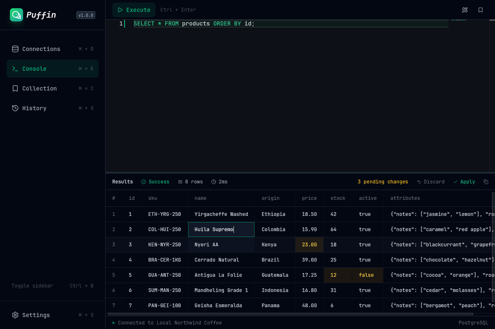
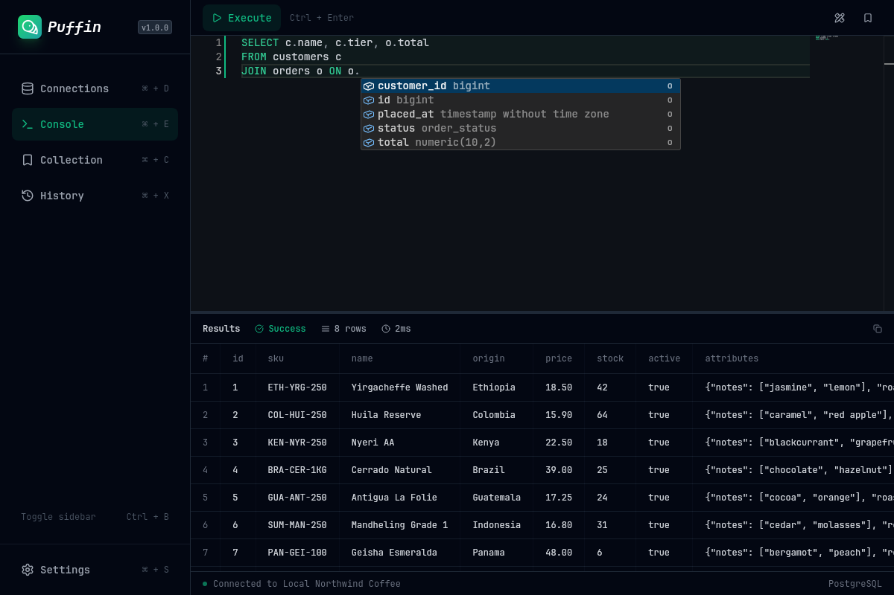
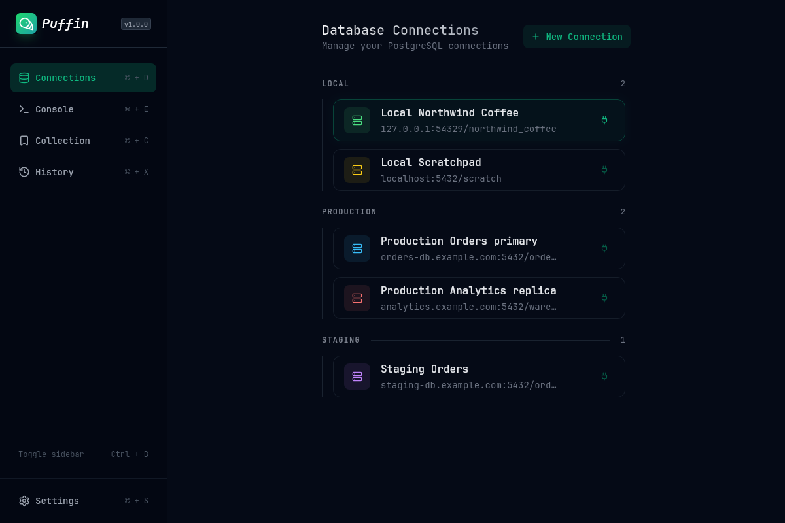
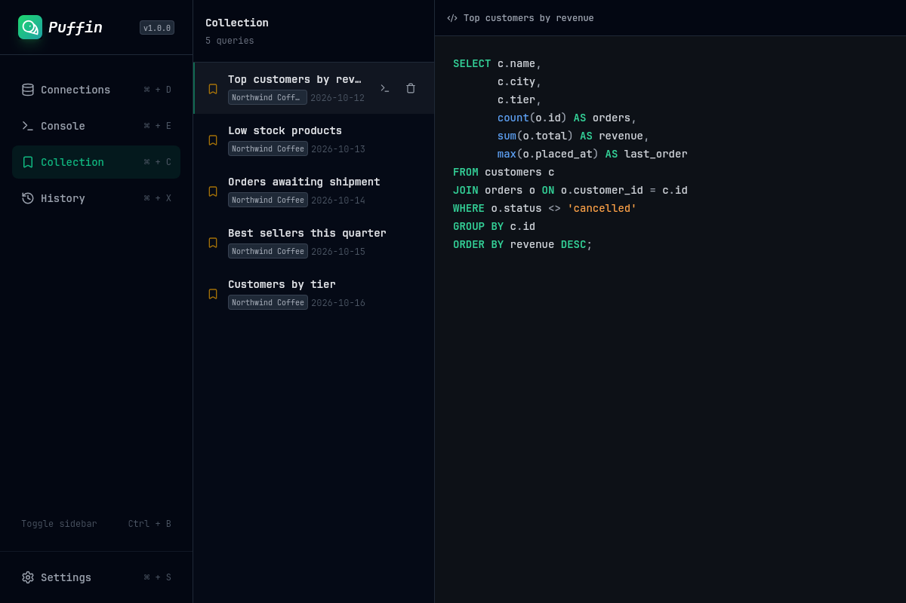
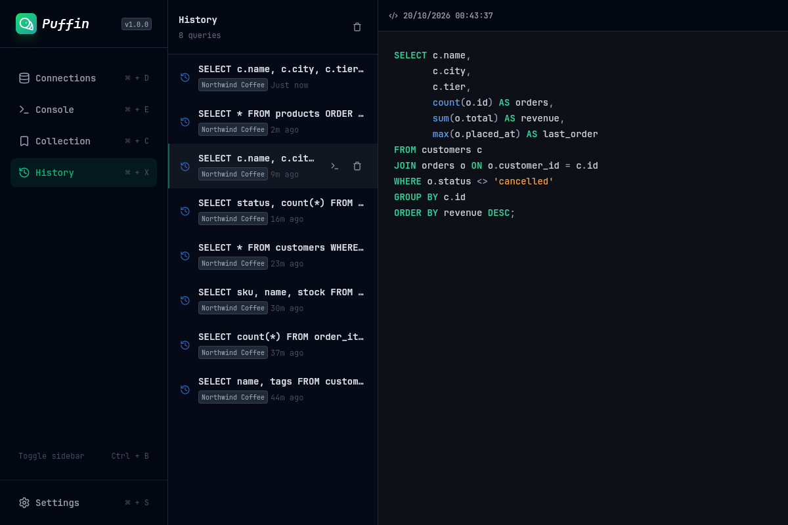
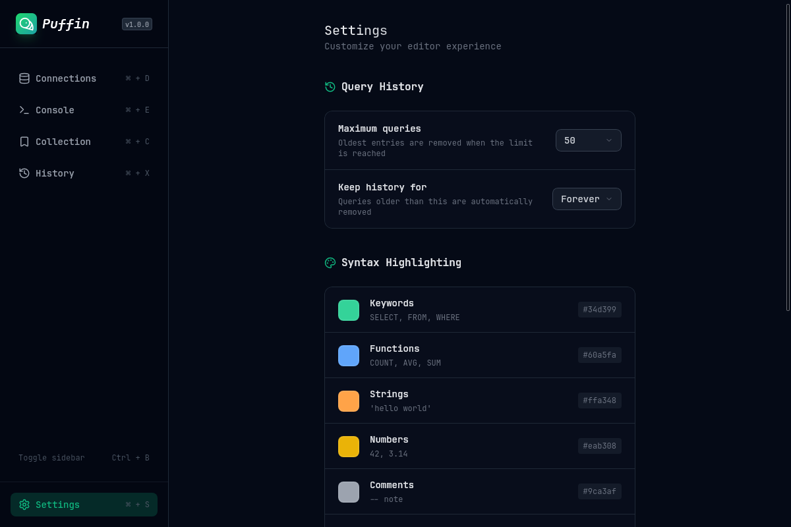

<div align="center">
  

  <h1>Puffin</h1>

  <p>A fast, keyboard-friendly PostgreSQL client for the desktop.</p>

  <p>
    <a href="#installation">Installation</a> ·
    <a href="#features">Features</a> ·
    <a href="#configuration">Configuration</a> ·
    <a href="#development">Development</a>
  </p>

  <p>
    <a href="LICENSE"></a>
    
    
  </p>
</div>

<br>



Puffin is a lightweight PostgreSQL GUI built with Tauri, Rust and Vue. It focuses on the day-to-day loop of writing queries, reading results and making quick fixes to data, without the weight of a full database IDE.

## Features

- **Query console** powered by Monaco, with Ctrl+Enter to run the statement under the cursor and one-key SQL formatting.
- **Schema-aware autocomplete** for schemas, tables, views, columns (with their types), table aliases, CTEs, functions and SQL keywords.
- **Inline cell editing**: right-click a cell, edit it in place, review the highlighted changes and apply them all in a single transaction.
- **Rich type rendering** for numeric, json/jsonb, arrays (including multidimensional), enums, uuid, dates and times, intervals, inet/cidr and bytea.
- **Copy anything**: a single cell from its context menu, or the whole result set as a pretty table or CSV.
- **Connection manager** with groups, color-coded cards and encrypted passwords.
- **Collection** of saved queries with a live preview, ready to send back to the console.
- **History** of every query you run, with configurable size and retention.
- **Customizable syntax highlighting** with a live preview.
- **Keyboard-first navigation**, zoom controls and a collapsible sidebar.

## Screenshots

<table>
  <tr>
    <td width="50%"></td>
    <td width="50%"></td>
  </tr>
  <tr>
    <td align="center"><sub>Inline editing with pending changes</sub></td>
    <td align="center"><sub>Schema-aware autocomplete</sub></td>
  </tr>
  <tr>
    <td width="50%"></td>
    <td width="50%"></td>
  </tr>
  <tr>
    <td align="center"><sub>Connections</sub></td>
    <td align="center"><sub>Collection</sub></td>
  </tr>
  <tr>
    <td width="50%"></td>
    <td width="50%"></td>
  </tr>
  <tr>
    <td align="center"><sub>History</sub></td>
    <td align="center"><sub>Settings</sub></td>
  </tr>
</table>

## Installation

Puffin is distributed as a Nix flake and currently targets Linux.

Try it without installing:

```sh
nix run github:LuizFerK/puffin
```

Install it into your user profile:

```sh
nix profile install github:LuizFerK/puffin
```

Or add it to a flake-based NixOS or home-manager configuration:

```nix
# flake.nix
inputs.puffin.url = "github:LuizFerK/puffin";
```

```nix
# any module that receives `inputs`
home.packages = [
  inputs.puffin.packages.${pkgs.stdenv.hostPlatform.system}.default
];
```

The package ships a desktop entry and icons, so Puffin shows up in your application launcher. Update it with `nix flake update puffin`.

Puffin is built from source on your machine, so the first install takes a few minutes.

## Usage

### Keyboard shortcuts

| Shortcut | Action |
| --- | --- |
| <kbd>Ctrl</kbd> + <kbd>Enter</kbd> | Run the statement under the cursor |
| <kbd>Ctrl</kbd> + <kbd>S</kbd> | Format the query (inside the editor) |
| <kbd>Ctrl</kbd> + <kbd>Shift</kbd> + <kbd>D</kbd> | Connections |
| <kbd>Ctrl</kbd> + <kbd>Shift</kbd> + <kbd>E</kbd> | Console |
| <kbd>Ctrl</kbd> + <kbd>Shift</kbd> + <kbd>C</kbd> | Collection |
| <kbd>Ctrl</kbd> + <kbd>Shift</kbd> + <kbd>X</kbd> | History |
| <kbd>Ctrl</kbd> + <kbd>Shift</kbd> + <kbd>S</kbd> | Settings |
| <kbd>Ctrl</kbd> + <kbd>B</kbd> | Toggle the sidebar |
| <kbd>Ctrl</kbd> + <kbd>=</kbd> / <kbd>Ctrl</kbd> + <kbd>-</kbd> / <kbd>Ctrl</kbd> + <kbd>0</kbd> | Zoom in, zoom out, reset zoom |
| <kbd>F11</kbd> | Toggle fullscreen |

### Editing data

Right-click any cell in the results and choose **Edit**. Press <kbd>Enter</kbd> to confirm or <kbd>Esc</kbd> to cancel; the context menu also offers **Set NULL** for nullable columns and **Revert** for modified cells. Changes stay highlighted until you click **Apply** in the results header, which writes them all in one transaction, or **Discard**.

A cell is editable when its column comes from a table (not a view or an expression) and the table's full primary key is part of the result. When a cell can't be edited, the menu tells you why. Values are sent as text and cast by PostgreSQL, so any input format PostgreSQL accepts for the column type works.

### Results

Each query returns at most 500 rows. Use the copy button in the results header to copy them as a pretty table or CSV, with or without the index column and column names.

## Configuration

Everything is configured from the **Settings** page and saved automatically.

| Setting | Options | Default |
| --- | --- | --- |
| Maximum history entries | 10, 25, 50, 100, 200, 500 | 50 |
| History retention | 1 day, 1 week, 2 weeks, 1 month, 1 year, forever | Forever |
| Syntax colors | Keywords, functions, strings, numbers, comments, types, punctuation, identifiers | Puffin theme |

Each section can be reset to its defaults.

### Data storage

Puffin keeps its data as JSON files in `~/.local/share/puffin/`:

| File | Contents |
| --- | --- |
| `connections.json` | Saved connections and the active one |
| `queries.json` | Collection, history and the console's current text |
| `settings.json` | Settings |

Connection passwords are encrypted with AES-256-GCM before they are written to disk. The key is embedded in the application, so this keeps passwords out of plain sight but does not protect them from someone who has access to your files and the Puffin binary.

## Tech stack

| Layer | Technologies |
| --- | --- |
| Desktop shell | [Tauri 2](https://tauri.app) |
| Backend | Rust, [tokio-postgres](https://github.com/sfackler/rust-postgres) |
| Frontend | [Vue 3](https://vuejs.org), TypeScript, [Vite](https://vite.dev) |
| Editor | [Monaco Editor](https://microsoft.github.io/monaco-editor/), [sql-formatter](https://github.com/sql-formatter-org/sql-formatter) |
| Styling | [UnoCSS](https://unocss.dev), [Lucide](https://lucide.dev) icons |
| Testing | [Vitest](https://vitest.dev), `cargo test` |
| Packaging | [Nix](https://nixos.org) flakes, pnpm |

## Development

The development environment is defined in the flake, so the only requirement is Nix with flakes enabled.

```sh
git clone https://github.com/LuizFerK/puffin.git
cd puffin
nix develop
pnpm install
cargo tauri dev
```

Run the tests:

```sh
pnpm test                       # frontend
(cd src-tauri && cargo test)    # backend
```

Build the package the same way users get it:

```sh
nix build
./result/bin/puffin
```

### Project structure

```
src/                 Vue frontend
  components/        UI components, grouped by page
  composables/       Shared state and logic (autocomplete, result edits)
  helpers/           Pure functions, covered by unit tests
  pages/             Connections, Console, Collection, History, Settings
  sql/completion/    SQL tokenizer and autocomplete engine
  stores/            Persistent state backed by the Tauri store plugin
src-tauri/           Rust backend
  src/lib.rs         Tauri commands: queries, schema, cell edits
  src/decode.rs      PostgreSQL binary value decoding
test/                Frontend unit tests
```

### Updating dependencies

The Nix build fetches frontend dependencies from `pnpm-lock.yaml` and pins them by hash. Whenever the lockfile changes, update the `pnpmDeps` hash in `flake.nix`: set it to `lib.fakeHash`, run `nix build`, and copy the correct hash from the error message.

## Contributing

Issues and pull requests are welcome. Please run both test suites before opening a pull request, and use [Conventional Commits](https://www.conventionalcommits.org) for commit messages.

## License

Puffin is released under the [MIT License](LICENSE).
